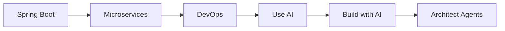

This is the Official repository of **Java Spring Boot: Professional eCommerce Project Masterclass** on Udemy

# The Complete Java Developer Roadmap: Core Engineering to AI-Native Systems

Welcome to your one-stop-shop for mastering Java, Spring Boot and AI engineering! This repository is part of the EmbarkX learning path, with **300+ hours of hands-on, project-based content** and community support.

Start by mastering production-grade Java, Spring Boot, microservices and DevOps, the foundation every senior engineer needs. Then layer in AI: tools, frameworks and multi-agent systems built specifically for the Java ecosystem.

> 🎓 All courses below are available in **Udemy Business**. If your company has a subscription, you get **FREE** access.
>
> 🗺️ See the full interactive roadmap with the latest coupons at **[embarkx.com/roadmap](https://embarkx.com/roadmap)**

---

## 🧱 Phase 1: Core Engineering Path

Production-grade Java, Spring Boot, microservices and cloud deployment. The skills every backend role demands.

### Step 1: [Java Spring Boot Full Stack eCommerce](https://link.embarkx.com/spring-boot) (90+ Hours)
Build a full-featured eCommerce app from scratch: REST APIs, Spring Security with JWT, the DTO pattern, AWS deployment, then a JavaScript and React frontend to tie it all together.

`Spring Boot` `Spring Data JPA` `Spring Security 7` `JWT` `REST API` `React` `AWS`

### Step 2: [Spring Boot eCommerce Microservices Masterclass](https://link.embarkx.com/microservices) (70+ Hours)
Transform a monolithic eCommerce app into a production-ready microservices system with Spring Cloud, Docker, Kafka, Kubernetes and distributed tracing.

`Microservices` `Spring Cloud` `Docker` `Kubernetes` `RabbitMQ` `Kafka` `Zipkin`

### Step 3: [Full Stack AI DevOps for Software Developers (AWS, Azure, GCP)](https://link.embarkx.com/devops) (50+ Hours)
Docker, Kubernetes, CI/CD pipelines and Infrastructure as Code. Deploy real Spring Boot apps across all three major cloud platforms.

`Docker` `Kubernetes` `CI/CD` `Terraform` `GitHub Actions` `AWS` `Azure` `GCP`

---

## 🤖 Phase 2: The AI Roadmap for Java Developers

From using AI tools daily to architecting multi-agent systems, all grounded in the Java ecosystem you already know.

**Use AI → Build with AI → Architect AI Systems**

### 01 · Use AI: [AI Productivity for Developers](https://embarkx.com/ai-productivity)
*Udemy: GenAI & AI Agents for Java Spring Boot Devs | Copilot, Claude*

Master the AI tools that make you a far more productive Java developer, and build AI agents that do real engineering work.

`Claude Code` `Cursor` `MCP` `Agentic Workflows` `GitHub Copilot` `n8n`

**Outcome:** Ship faster, write better code, spend less time on boilerplate.

### 02 · Build with AI: [AI-Powered Applications](https://embarkx.com/spring-ai)
*Udemy: AI-Powered Java Applications with Spring AI 2.0 & Spring Boot 4*

Go beyond using AI tools and build production-ready AI applications, from your first ChatClient call to a full streaming chatbot.

`Spring AI 2.0` `Spring Boot 4` `Advisors` `RAG + pgvector` `Tool Calling` `AI Agents` `MCP`

**Outcome:** Build Java apps that use LLMs as a core component, not a bolt-on.

### 03 · Architect Agents: [Multi-Agent Systems](https://embarkx.com/multi-agent)
Design, build and orchestrate systems where multiple AI agents collaborate, all in Java.

`Multi-Agent Patterns` `Agent Orchestration` `Observability`

**Outcome:** Architect production-grade multi-agent systems, a rare skill set among Java developers today.
---

## 🎯 Deep Dive Specializations

Focused, project-based courses that go deeper on a single topic. Start anywhere based on your gap.

| Course | Focus | Hours |
|---|---|---|
| [Full Stack Spring Security 7 + ReactJS, OAuth2, JWT](https://link.embarkx.com/spring-security) | Spring Security 7, OAuth2, JWT, MFA, React | 34+ |
| [Java Programming for Beginners: Core Java Using IntelliJ](https://link.embarkx.com/java) | Java 17/21, OOP, IntelliJ | 63+ |
| [Spring Data JPA & Hibernate: Basics to Advanced](https://embarkx.com/roadmap#specializations) | JPA, Hibernate, JPQL, Criteria API | 14+ |
| [Master IntelliJ IDEA](https://link.embarkx.com/intellij) | IDE productivity for Java developers | 3+ |

---

## 🌟 With All Our Courses You Gain Access To

- 📝 **Notes:** Detailed and downloadable notes to accompany each lesson.
- 💻 **Source Code:** Full access to the source code used in the tutorials.
- 🤔 **Doubt Solving:** Responsive instructor and community support.
- 🎥 **High-Quality HD Videos:** Easy to understand, high-definition video tutorials.
- 🔄 **Free Lifetime Updates:** Continuous updates to course content at no extra cost.

## 📚 Why Choose This Roadmap?

- **Production-ready, not tutorial-ready:** every course is built around real, deployable projects.
- **One continuous path:** each course builds on the previous one, from core Java all the way to multi-agent AI systems.
- **Java-native AI:** learn AI engineering with Spring AI and the tools you already use. No ecosystem switching required.
- **For any stage:** whether you're a fresher starting with Java basics or a seasoned Spring Boot engineer going AI-native.

## 🎁 More From EmbarkX

- 💸 **[Monthly promo codes and free coupons](https://subscribe.embarkx.com/)**
- 🧰 **[Free IntelliJ IDEA Ultimate](https://intellij.embarkx.com/)**
- 🗺️ **[Interactive Developer Roadmap](https://embarkx.com/roadmap)**

### Join Us Now!

Start your journey today to become a production-ready Java engineer. Our community and instructors are here to support your learning every step of the way. **Enroll and start building your future, today!**

---

# Usage Policy for Course Materials

## Instructor Information

**Instructor:** Faisal Memon  
**Company:** [EmbarkX.com](http://www.embarkx.com)

## Policy Overview

This document outlines the guidelines and restrictions concerning the use of course materials provided by EmbarkX, including but not limited to PDF presentations, code samples, and video tutorials.

### 1. Personal Use Only

The materials provided in this course are intended for **your personal use only**. They are to be used solely for the purpose of learning and completing this course.

### 2. No Unauthorized Sharing or Distribution

You are **not permitted** to share, distribute, or publicly post any course materials on any websites, social media platforms, or other public forums without prior written consent from the instructor.

### 3. Intellectual Property

All course materials are protected by copyright laws and are the intellectual property of Faisal Memon and EmbarkX. Unauthorized use, reproduction, or distribution of these materials is **strictly prohibited**.

### 4. Reporting Violations

If you become aware of any unauthorized sharing or distribution of course materials, please report it immediately to [embarkxofficial@gmail.com](mailto:embarkxofficial@gmail.com).

### 5. Legal Action

We reserve the right to take legal action against individuals or entities found to be violating this usage policy.

## Thank You

Thank you for respecting these guidelines and helping us maintain the integrity of our course materials.

## Contact Information

- **Email:** [embarkxofficial@gmail.com](mailto:embarkxofficial@gmail.com)
- **Website:** [www.embarkx.com](http://www.embarkx.com)
